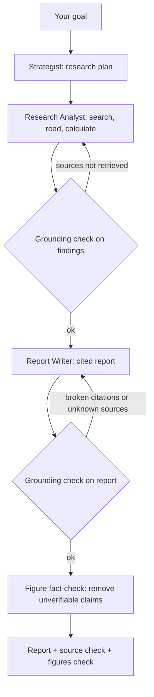

<div align="center">

# 🤖 Autonomous AI Research Agent

**Give it a goal. It plans, searches the web and your documents, does the maths, and delivers a sourced report. Every number in that report is fact-checked against what the agent actually read.**

[](https://www.python.org/)
[](https://www.crewai.com/)
[](https://console.groq.com/)
[](https://streamlit.io/)
[](tests/test_agent.py)
[](LICENSE)

[Overview](#-overview) · [How it works](#-how-it-works) · [Trust layer](#%EF%B8%8F-the-trust-layer) · [Engineering challenges](#-engineering-challenges) · [Quick start](#-quick-start) · [Deployment](#-deployment) · [Limitations](#-limitations)

</div>

---

## 📌 Overview

Research tasks such as *"Find top EV market trends in India for 2027"* take an analyst hours: plan the
questions, search, read, cross-check numbers, write it up. This project hands that loop to a team of three
AI agents built with **CrewAI**:

| Agent | Job | Tools |
|---|---|---|
| 📋 **Strategist** | Turns the goal into 3–5 concrete research questions and a report outline | none |
| 🔎 **Research Analyst** | Answers each question in a think → act → observe loop and records every fact with its source | `web_search`, `read_webpage` (HTML + PDF), `doc_reader`, `calculator` |
| 📦 **Report Writer** | Writes a decision-ready Markdown report with numbered citations | none |

Language models are confident writers, and an agent that browses the web can easily cite a page it never
opened or quote a number that appears nowhere. So the agents' output goes through a **trust layer** written in
plain Python: it verifies sources and numbers, and removes what it can't verify before the report reaches you.

It runs **entirely on free tiers**: Groq's free API for the model, DuckDuckGo for search, and Streamlit
Community Cloud for hosting.

## 🧭 How it works



The app streams every step live (each tool call, rate-limit wait, guardrail result and task completion),
then shows the report with a **source check** and **figures check** score, the plan, the raw findings,
a list of claims the fact-checker removed, and a Markdown download.

## 🛡️ The trust layer

Everything the tools return during a run (search results, pages, PDFs, workspace documents, calculator
results) is recorded, **keyed by the source it came from**. The checks then compare the agents' text with that record:

| Check | Rule | On failure |
|---|---|---|
| **Source check** | Every cited URL or file must have been returned by a tool in *this* run, and every entry in Sources must have a URL or file | Sent back to the agent with the exact list; claims resting on unopenable sources are removed |
| **Figure fact-check** | Every figure (percentages, ₹/$ amounts, crore/lakh/million, kW/GWh, large or precise numbers) must appear **in the source cited on the same line**, with the same unit | The sentence or table row is removed and listed under "claims removed" |
| **Citation check** | Every `[n]` must point to a numbered source with a URL or file | Sent back to the writer, then renumbered automatically |
| **Refusal guard** | A retry that answers "I'm sorry, I can't…" never replaces a real report | The best earlier attempt is kept and flagged |

Some design choices worth noting:

- **Code enforces the facts, not the model.** Asking a model to "fix" its numbers costs a full rewrite and sometimes
  produces a refusal instead. Removing an unverifiable sentence is deterministic, free, and can't be argued with.
  Nothing is "corrected": a claim either stands on its source or disappears.
- **Number formats are normalised.** `1,500 = 1500`, `40% = 40 per cent`, `Rs = ₹`, `cr = crore`, `L = lakh`.
  Ranges like `35–40 %` are checked at both ends, and years and list numbering are ignored.
- **Per-source, not run-wide.** A real "20%" from one page can't vouch for a claim that cites a different page.
- **Clean output after removal.** Emptied tables and sections disappear, numbered lists are renumbered, and Sources
  are renumbered with every `[n]` rewritten to match.

In test runs on the EV-trends goal, the open model invented plenty of numbers: segment growth rates given twice
with different values, 2027 market shares, subsidy amounts credited to articles that don't contain them, and
"proprietary" sources with no link. The trust layer removed **12 to 31 such claims per run**, and every figure
left in the final reports was traceable to the page it cites.

## 🧗 Engineering challenges

Getting a multi-agent system to run reliably on a free API took more than the agents themselves:

| Problem | What happened | Fix |
|---|---|---|
| Free-tier rate limits | Groq's ~8K tokens/minute limit returned 429 errors mid-run | Own retry loop that reads Groq's `try again in …` hint; requests/minute capped; tool outputs truncated |
| Silent hangs | Runs froze with no error | `faulthandler` stack dumps showed CrewAI sleeping on an uncapped `retry_after` when the **daily** quota ran out; a daily-quota error is now raised at once and shown as a clear message |
| Tool calling | gpt-oss replied "Tool choice is none" | A small `LLM` subclass that turns on native function calling |
| Refusals | After hitting its iteration cap the model answered "I can't comply" | CrewAI's "force final answer" prompt replaced with a neutral one, plus the refusal guard above |
| Model glitches | Occasional `output_parse_failed` / `tool_use_failed` / timeouts | Retried as transient errors, separately from rate limits |
| Token cost | Enforcing figures at every stage re-ran all searches (≈270K tokens/run) | Figures enforced once, at the end, by code; research retries only for source problems |
| Python version | CrewAI has no wheels for Python 3.14 | Project pinned to Python 3.12 |

## 🗂 Project structure

```text
├── app.py                Streamlit UI: goal → live step log → report / plan / findings tabs + download
├── main.py               CLI:  python main.py "your goal"
├── agent/
│   ├── crew.py           Agents, tasks, guardrails, fact-check, retry logic, run()
│   ├── tools.py          web_search, read_webpage, doc_reader, calculator + evidence recording
│   └── config.py         Settings from .env / Streamlit secrets
├── workspace/            Internal docs the agent may read (sample EV notes included)
├── outputs/              Generated reports (git-ignored)
└── tests/test_agent.py   Offline tests (no API key or internet needed)
```

## 🚀 Quick start

Requires **Python 3.12** and a free [Groq API key](https://console.groq.com/keys).

```powershell
git clone https://github.com/arpit-k16/autonomous-ai-research-agent.git
cd autonomous-ai-research-agent
py -3.12 -m venv .venv
.\.venv\Scripts\Activate.ps1          # macOS/Linux: source .venv/bin/activate
pip install -r requirements.txt

copy .env.example .env                # then paste your GROQ_API_KEY into .env

pytest -q                             # offline tests
streamlit run app.py                  # http://localhost:8501
python main.py "Find top EV market trends in India for 2027"   # or use the CLI
```

A full run takes 3–8 minutes on the free tier (most of it waiting for the per-minute token limit) and can use
around 200K tokens (one test run used ≈220K). If you hit the daily limit, switch `CHAT_MODEL` to `openai/gpt-oss-20b`, which has a
separate daily quota.

## ⚙️ Configuration

All settings live in `.env` (locally) or Streamlit Secrets (cloud):

| Variable | Default | Purpose |
|---|---|---|
| `GROQ_API_KEY` | — | Required. Free at console.groq.com |
| `LLM_PROVIDER` | `groq` | `groq` or `openai` |
| `CHAT_MODEL` | `openai/gpt-oss-120b` | Also works: `openai/gpt-oss-20b` |
| `MAX_RPM` | `10` | Requests per minute sent to the model |
| `MAX_ITER` | `10` | Tool-loop iterations per agent |
| `SEARCH_RESULTS` | `4` | Results per web search |
| `PAGE_CHARS` | `2000` | Characters kept from each page or document |
| `REASONING_EFFORT` | `low` | gpt-oss thinking budget; `low` saves many tokens |

## ☁️ Deployment

Free on **Streamlit Community Cloud**:

1. Fork or push this repo to GitHub (`.env` and `outputs/` are git-ignored).
2. On [share.streamlit.io](https://share.streamlit.io) choose **Create app**, pick the repo and `app.py`.
3. Under **Advanced settings**, set **Python 3.12** and add the secret `GROQ_API_KEY = "gsk_..."`.
4. Deploy.

The app runs one agent at a time per server, because the evidence record is process-wide and the free API
quota is shared. Files uploaded in the sidebar are visible to everyone on the same server.

## ⚠️ Limitations

- The figure check proves a number **appears in the cited source**, not that the sentence uses it correctly.
  A claim can still be misread from a correct page.
- Search snippets are short, so many true numbers are removed simply because the agent never opened the full page.
  The reports are deliberately conservative: fewer numbers, all traceable.
- Statements without numbers are checked only through their sources, not word by word.
- Free-tier speed: most of a run is spent waiting for rate limits.

## 🛣 Roadmap

- A semantic check (does the cited passage actually support the sentence?) using a small NLI model.
- Let the analyst re-open a page when a key number fails the check, instead of only removing it.
- Per-session workspaces and evidence so several users can run at once.
- Scheduled runs (for example a weekly market brief) via GitHub Actions.

## 📄 License

[MIT](LICENSE) © Arpit Kumar
