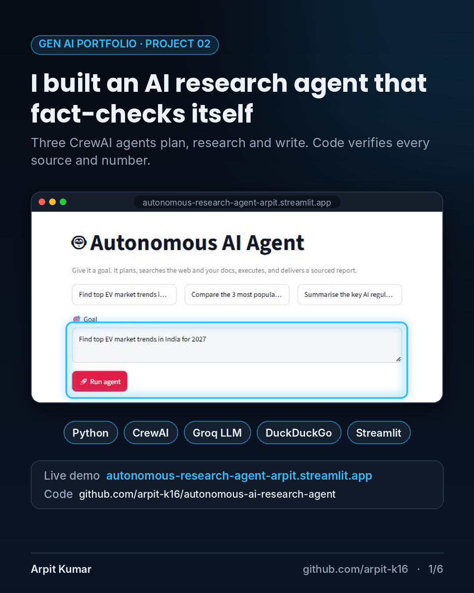
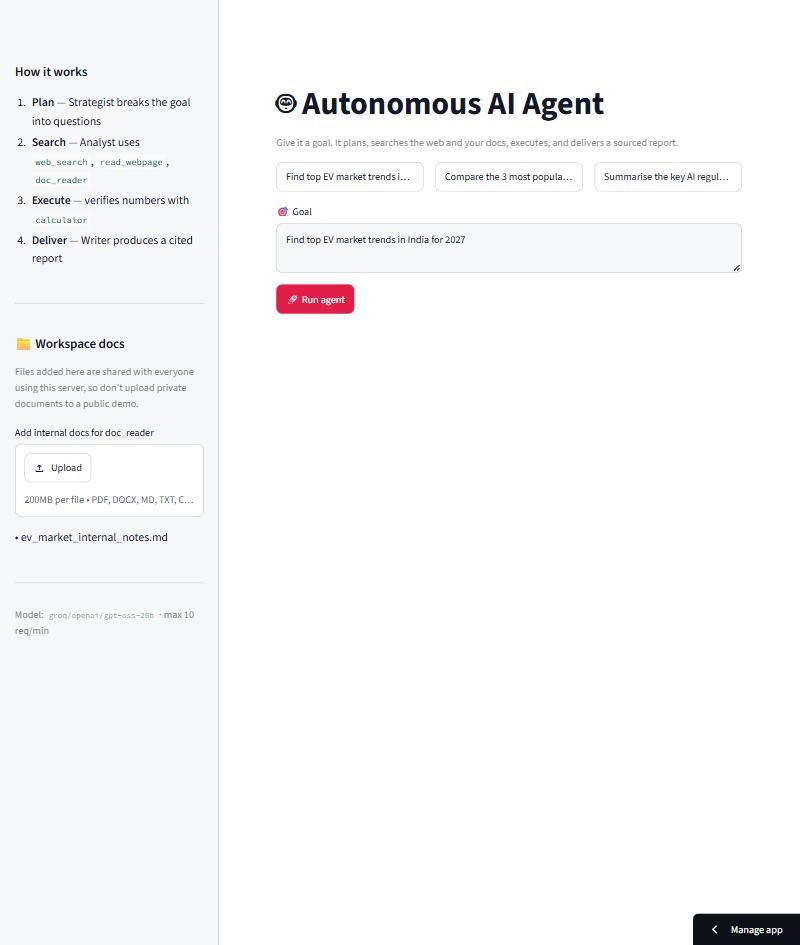
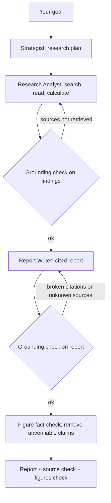
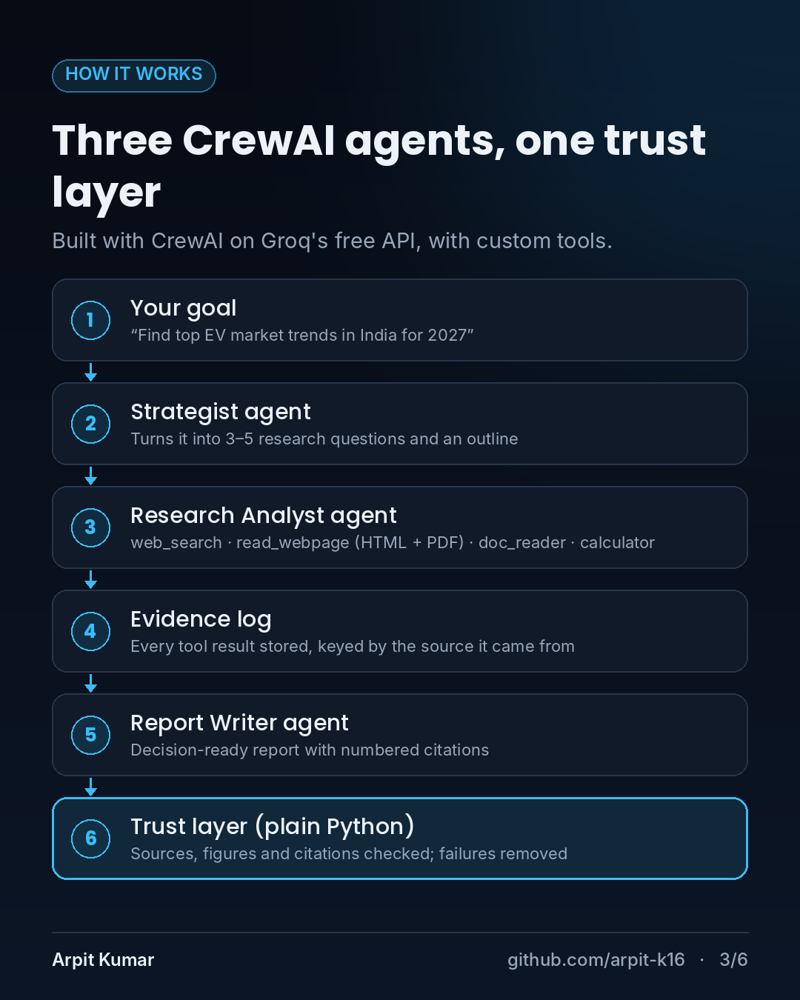
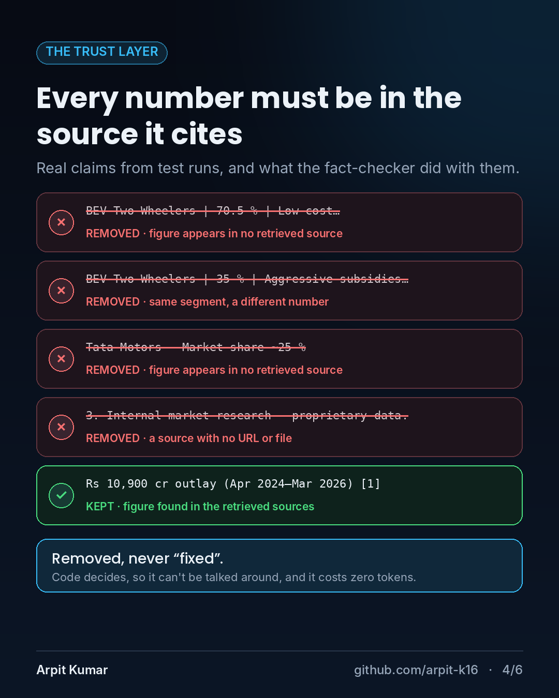
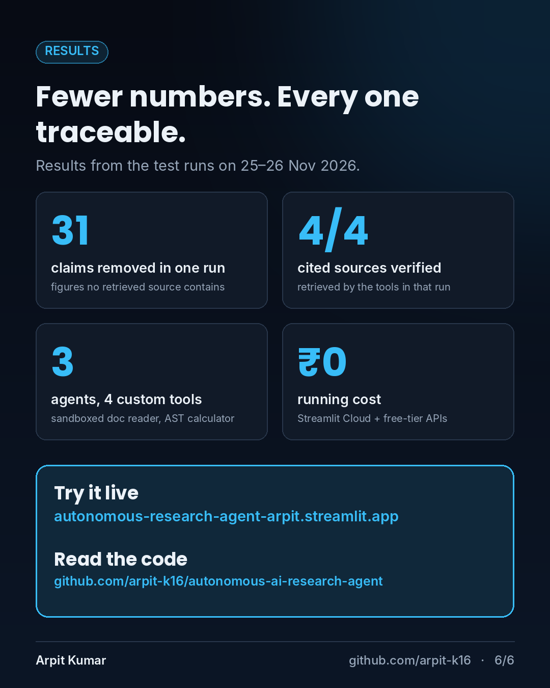

# Autonomous AI Research Agent: Project Report

**Author:** Arpit Kumar ([@arpit-k16](https://github.com/arpit-k16))  
**Project:** Gen AI Portfolio, Project 2 of 6  
**Date:** November 2026  
**Live demo:** <https://autonomous-research-agent-arpit.streamlit.app>  
**Source code:** <https://github.com/arpit-k16/autonomous-ai-research-agent>  
**Showcase video:** [`docs/showcase.mp4`](showcase.mp4) (51 s)

---

## Table of contents

1. [Executive summary](#1-executive-summary)
2. [Problem statement](#2-problem-statement)
3. [Objectives and scope](#3-objectives-and-scope)
4. [Solution overview](#4-solution-overview)
5. [System architecture](#5-system-architecture)
6. [Component deep-dive](#6-component-deep-dive)
7. [The trust layer](#7-the-trust-layer)
8. [Technology choices](#8-technology-choices)
9. [Test runs and results](#9-test-runs-and-results)
10. [Testing](#10-testing)
11. [Deployment](#11-deployment)
12. [Engineering challenges and how they were solved](#12-engineering-challenges-and-how-they-were-solved)
13. [Security and privacy](#13-security-and-privacy)
14. [Limitations](#14-limitations)
15. [Future work](#15-future-work)
16. [Showcase assets](#16-showcase-assets)
17. [Appendix](#17-appendix)

---

## 1. Executive summary

This project is an autonomous research assistant. The user types a goal such as *"Find top EV market trends
in India for 2027"*. A team of three AI agents, built with **CrewAI** and running on **Groq's free API**, plans the
research, searches the web and the user's own documents, does the arithmetic, and writes a decision-ready Markdown
report with numbered citations.

The distinctive part is what happens after the agents finish. Open models write confidently and cite freely,
so the system includes a **trust layer written in plain Python** that does not rely on the model at all:

- every cited URL or file must have been returned by one of the agent's tools **in that same run**;
- every figure (percentages, ₹ and $ amounts, crore, lakh, million, kW and similar) must appear **in the source cited on
  the same line**, with the same unit;
- every `[n]` citation must point to a listed source that has a URL or file.

Claims that fail are **removed, never "fixed"**, and listed in the app so the reader can see what was cut.
In the test runs on 25–26 November 2026, the trust layer removed **between 12 and 31 claims per run** with figures
that no retrieved source contained, including invented market shares, two contradictory growth rates for the
same segment, and "proprietary" sources with no link.

The whole system runs on free tiers: Groq for the language model, DuckDuckGo for search, and Streamlit Community
Cloud for hosting.



## 2. Problem statement

Desk research is slow: plan the questions, search, read, cross-check numbers, then write it up. Language models
promise to shortcut this, but they have a well-documented weakness with sources. In one 2023 study, ChatGPT-3.5
was asked to write 30 short medical papers; of the 115 references it produced, **47% were fabricated**, 46% were
real but inaccurate, and **only 7% were authentic and accurate** (Bhattacharyya et al., *Cureus* 15(5), 2023,
doi:10.7759/cureus.39238). Newer models do better, but the failure mode is the same: a fluent answer whose
numbers and citations cannot be trusted without checking each one by hand.

An *agent* that browses the web makes this both better and worse. It can fetch real pages, but it can also cite a
page it never opened, mix a number from memory into a sentence that cites a real page, or invent an "internal
report" as a source. This project's own test runs showed all three (see [section 9](#9-test-runs-and-results)).

**Goal of the project:** keep the speed of an autonomous agent, but make every number in the output traceable to a
page the agent actually read, and remove what isn't.

## 3. Objectives and scope

| Objective | How it is met |
|---|---|
| Autonomy: plan, act, observe, repeat | Three CrewAI agents; the Research Analyst runs a tool-calling loop capped by `MAX_ITER` |
| Real-world actions through tools | `web_search`, `read_webpage` (HTML and PDF), `doc_reader` (workspace files), `calculator` |
| Grounded, checkable output | Trust layer: source check, per-source figure check, citation check, refusal guard |
| Transparency | Live step log of every tool call, wait and check; removed claims listed in the UI |
| Zero running cost | Groq free tier, DuckDuckGo, Streamlit Community Cloud |
| Robustness on a free API | Own retry logic for rate limits, clear daily-quota errors, timeouts and size caps on every fetch |

**Out of scope:** paid search APIs, user accounts, long-term memory between runs, and semantic verification of
statements without numbers (see [section 14](#14-limitations)).

## 4. Solution overview



The user picks an example goal or types one, then clicks **Run agent**. While the agents work, the app streams a
step log: each tool call, each wait for Groq's rate limit, and each guardrail result. At the end it shows:

- the **report**, with numbered citations and a Sources list;
- a **source check** (how many cited sources were really retrieved by the tools) and a **figures check**;
- an expander listing the **claims the fact-checker removed**, struck through;
- the **plan** and the **raw findings** in separate tabs, and a Markdown download.

A command-line entry point (`python main.py "your goal"`) runs the same pipeline without the UI.

## 5. System architecture



The crew runs **sequentially** (`Process.sequential`): plan, then research, then report. Each task's output is the
next task's context. Two CrewAI **task guardrails** sit after the research and report tasks. A guardrail can
send the task back to its agent once with specific feedback; after that, the best attempt is kept, flagged in
the UI, and passed through the deterministic figure scrubber.

All tool output is written to an **evidence log**, keyed by the source it came from. The trust layer reads only
this log and the agents' text; it never asks the model whether something is true.



## 6. Component deep-dive

### 6.1 Agents and tasks (`agent/crew.py`)

| Agent | Role prompt (summary) | Iterations | Tools |
|---|---|---|---|
| Strategist | A senior consultant who breaks fuzzy goals into 3–5 specific questions and names the best source for each | 2 | none |
| Research Analyst | A meticulous analyst who checks internal documents first, then the web; reports **only** facts that appear in tool results from this session, each followed by its URL or file; writes "Not found in sources" otherwise | `MAX_ITER` (10) | all four |
| Report Writer | Writes crisp executive reports using **only** the analyst's findings, with `[n]` citations mapped to a Sources list; drops unsourced claims and flags gaps | 2 | none |

The report task asks for a fixed Markdown structure: title, executive summary, key findings, opportunities and
risks, recommended next steps, and a numbered Sources list. Today's date is injected into the plan, so the
agents search for current information rather than relying on training data.

### 6.2 Tools (`agent/tools.py`)

| Tool | What it does | Safety and limits |
|---|---|---|
| `web_search` | DuckDuckGo text search (via `ddgs`), returns title, URL and snippet per result | Runs in a **child process** with a 30 s timeout, so a crash or hang in the native HTTP client costs one search, not the server |
| `read_webpage` | Fetches a URL and extracts readable text; detects PDFs by content type, extension or `%PDF-` header and parses them with `pypdf` | Streams with a 20 s total deadline and a 2 MB cap; output truncated to `PAGE_CHARS` (2,000) |
| `doc_reader` | Lists or reads PDF, DOCX, MD, TXT and CSV files in `workspace/` | Resolves paths and refuses anything outside the workspace (`../` traversal blocked) |
| `calculator` | Evaluates arithmetic such as CAGR | Parses with Python's `ast` and allows only numeric operators; never calls `eval` |

Every tool records the URLs or files it returned (`SEEN_SOURCES`) and the text it handed to the model
(`EVIDENCE`, plus `EVIDENCE_BY_SOURCE`). For search results, each result's snippet is stored under its own URL.

### 6.3 LLM wrapper and retries

Groq's gpt-oss models are used through LiteLLM with a small `LLM` subclass (`NativeToolLLM`) that:

- enables **native function calling**, which fixed a "Tool choice is none" error in text-mode tool use;
- retries up to 8 times on **per-minute rate limits**, sleeping for the delay Groq states in its error message
  (capped at 65 s), and on transient model glitches (`output_parse_failed`, `tool_use_failed`, timeouts);
- turns a **daily quota** error into an immediate, non-retryable `ServiceQuotaExceededException`, so the app shows
  a clear message instead of waiting for hours.

`REASONING_EFFORT=low` keeps gpt-oss's hidden reasoning short, which saves a large share of tokens.

### 6.4 Streamlit app (`app.py`)

The crew runs in a **background thread**; the UI thread drains an event queue and updates a `st.status` box,
which is why the step log stays live during long rate-limit waits. Streamlit Cloud secrets are copied into
environment variables before settings are read. Only one run is allowed per server at a time (a process-wide
lock), because the evidence log is process-wide and the free API quota is shared. Errors are classified into
daily-quota, rate-limit and other errors, with the raw message in an expander.

## 7. The trust layer

### 7.1 Source check

`verify_sources()` extracts every URL and file name the text cites and compares it, after normalisation (lower
case, no scheme or `www.`, no trailing slash), with the sources the tools really returned. File names inside URLs
(for example a PDF link) are not counted twice. Entries in the Sources list that have **no URL or file at all**
(such as "Internal market research – proprietary data") are reported as unverified.

| Stage | Pass condition |
|---|---|
| Research findings | At least 3 verified sources, and at least 70% of cited sources verified |
| Final report | At least 3 verified sources, no unverified ones, no broken citations |

### 7.2 Figure fact-check

`check_figures()` finds every figure: a number with a currency (₹, Rs, INR, $, USD) or a unit (%, per cent,
crore, cr, lakh, L, million, billion, trillion, GWh, GW, MWh, MW, kWh, kW, km), or a large or precise number. Years,
citation markers and list numbering are ignored, and ranges such as `35–40 %` are checked at both ends.

Formats are normalised before matching (`1,500 = 1500`, `40% = 40 per cent`, `Rs = ₹`, `cr = crore`,
`L = lakh`). For the magnitude units the number must appear **with the same unit**, so "1 million" is not
"supported" by a stray "1".

Crucially, the check is **per source**:

- a line that cites `[n]` or an inline URL or file is checked only against the evidence from *that* source (plus
  calculator results, which are derived numbers);
- a line with no citation is checked against the evidence of the sources listed in the report;
- only if no per-source evidence is available does it fall back to everything the run retrieved.

This closed a real loophole found during testing: a "~35%" claim had passed because "35%" appeared in an
unrelated search result.

### 7.3 Removal, not correction

`scrub_unsupported_figures()` removes any sentence (or whole table row) containing a figure that fails the check,
records it, and then tidies the result: citation-only leftovers like `- [1]` are dropped, emptied tables and
sections disappear, numbered lists are renumbered, sources without a URL or file are removed, and the remaining
sources are renumbered with every `[n]` in the text rewritten to match.

Asking the model to "fix" its numbers was tried first. It cost a full rewrite per attempt and, in one run, the
retry answered *"I'm sorry, but I don't have the necessary source material…"*, which then replaced a real report.
Deterministic removal is free, cannot be argued with, and never invents a replacement figure.



### 7.4 Refusal guard and best attempt

Each guardrail remembers its best attempt (scored by verified minus unverified sources). If the final retry is
weaker, or is a refusal, the earlier attempt is kept and flagged. A neutral replacement for CrewAI's
"force final answer" prompt also stopped the model from answering "I can't comply" when it hit its iteration cap.

## 8. Technology choices

| Need | Choice | Why |
|---|---|---|
| Agent framework | CrewAI 1.15.45 | Role-based agents, sequential tasks, task guardrails and an event bus for live progress |
| LLM | Groq `openai/gpt-oss-120b` or `-20b` | Free tier, fast inference, native tool calling; the two models have separate daily quotas |
| LLM routing | LiteLLM | Provider-agnostic; switching to OpenAI is one setting |
| Search | DuckDuckGo via `ddgs` | Free and keyless |
| Page parsing | requests, BeautifulSoup, pypdf | Lightweight and pure Python where possible |
| UI and hosting | Streamlit, Streamlit Community Cloud | Free hosting with secrets management |
| Python | 3.12 | CrewAI has no wheels for Python 3.14 yet |

## 9. Test runs and results

All runs used the goal *"Find top EV market trends in India for 2027"* on `openai/gpt-oss-20b` through Groq's free
tier. Each run exposed something, which was then fixed (section 12).

| Run (Nov 2026) | Duration · tool calls | Cited sources verified | Claims removed | What it revealed |
|---|---|---|---|---|
| 25 Nov, 18:01 | 451 s · 19 | 8/8 in findings | before the scrubber existed | 12 of 19 figures in the findings appeared in no source; the writer's retry was a refusal that replaced the report (≈219K tokens used) |
| 26 Nov, 09:56 | 175 s · 10 | 3/3 | 24 (14 findings + 10 report) | Table rows split into fragments; a result-field mix-up showed removed claims as "broken citations" |
| 26 Nov, 10:35 | 445 s · 17 | 4/4 | 12 (4 + 8) | A figure could be "verified" by an unrelated page; "₹1.5 L" not read as lakh; citation-only leftovers |
| 26 Nov, 10:49 | 204 s · 10 | 4/4 with a URL | 31 (20 + 11) | The writer invented two "internal, proprietary" sources with no link, which the URL-based check could not see |

Examples of claims the fact-checker removed (verbatim from the runs):

- `| BEV Two-Wheelers | 70.5 % | Low cost, high charging density, strong OEM push |`
- `| BEV Two-Wheelers | 35 % | Aggressive subsidies, expanding charging networks, low maintenance cost |`
  (the same segment, a different number, in the same run)
- `| 1 | Tata Motors | ~25 % | Local battery production, extensive charging network |`
- `3. Internal market research reports (BloombergNEF, McKinsey, NITI Aayog) – proprietary data.`

And one that was kept: the PM E-DRIVE outlay of **Rs 10,900 crore (April 2024 to March 2026)**, cited to the
Press Information Bureau release and present in the retrieved text.

**Reading the numbers honestly.** The reports that come out are shorter and carry fewer figures than the raw
model output, because the open model invents many numbers and search snippets are short. That is the intended
trade-off: fewer numbers, every one traceable to the page it cites.



## 10. Testing

`tests/test_agent.py` contains 32 offline tests that need no API key or internet. 31 of them also pass against a
lightweight CrewAI stub; `test_crew_wiring` needs the real CrewAI install. They cover:

- **tools:** CAGR through the calculator, code injection rejected, workspace listing and reading, path traversal
  blocked, search formatting and error handling, the page-size cap, PDF parsing, evidence recording;
- **retries:** timeouts retried, daily quota non-retryable, error classification;
- **source check:** unseen citations flagged, PDF names inside URLs not double-counted, link-less sources flagged;
- **figure check:** invented numbers and broken citations flagged, units must match, figures must come from the
  source they cite;
- **scrubber:** only unverifiable claims removed, table rows dropped whole, empty tables and sections removed,
  lists renumbered, sources renumbered;
- **guards:** guardrail retries then flags, refusals get plain feedback, a refusal on retry never replaces the real
  report, the "force final answer" prompt is neutral.

## 11. Deployment

The app is deployed on **Streamlit Community Cloud** at
<https://autonomous-research-agent-arpit.streamlit.app> with Python 3.12 and the Groq key in Secrets.
Dependencies are pinned to the exact versions the project was built with.

Two cloud-specific points:

- Groq's daily token allowance is **per account**, so heavy local testing and the public demo share it. When it
  runs out, the app says so and names the other free model, whose allowance is separate.
- The first deployed runs crashed with a segmentation fault about 45 s in. The crashes lined up with a debugging
  watchdog (Python's `faulthandler.dump_traceback_later`) that dumped every thread's stack every 45 s; it was
  removed, and web search was moved to a child process. At the time of writing, a full-length run on the cloud is
  still to be repeated once the daily quota resets, to confirm the fix.

## 12. Engineering challenges and how they were solved

| Problem | Cause | Fix |
|---|---|---|
| `pip install` failed | CrewAI has no wheels for the default Python 3.14 | Virtual environment created with `py -3.12` |
| "Tool choice is none" | gpt-oss in text-mode tool use | `NativeToolLLM` enables native function calling |
| 429 rate-limit errors mid-run | ~8K tokens per minute on the free tier | Own retry loop reading Groq's wait hint; requests per minute capped; tool output truncated |
| Runs froze with no error | `faulthandler` stack dumps showed CrewAI sleeping on an uncapped `retry_after` when the **daily** quota was exhausted | Daily-quota errors raised immediately as non-retryable, with a clear UI message |
| "I can't comply" answers | CrewAI's "force final answer" prompt at the iteration cap | Neutral replacement prompt |
| `output_parse_failed`, `tool_use_failed` | Occasional model glitches | Retried as transient errors |
| Findings without URLs, invented figures | The model writes from memory | Grounding guardrails and the figure fact-check |
| ≈270K tokens per run | Enforcing figures at every stage forced re-research | Figures enforced once, by code, at the end; research retries only for source problems |
| Refusal replaced a real report | The writer's retry gave up | Best-attempt tracking and refusal guard |
| Table fragments, wrong warning | Sentence splitting inside table rows; result fields passed positionally | Rows treated as one claim; keyword arguments |
| "Verified" by an unrelated page | Run-wide number matching | Evidence keyed by source; per-source check |
| Link-less "proprietary" sources | URL-based check could not see them | Link-less entries flagged, their claims removed, sources renumbered |
| Segfault on Streamlit Cloud | Debug watchdog dumping thread stacks (see section 11) | Watchdog removed; search moved to a child process |

## 13. Security and privacy

- The Groq key is read from `.env` locally or Streamlit Secrets in the cloud; `.env` is git-ignored and the
  repository was checked for keys before publishing.
- `doc_reader` cannot read outside `workspace/`; `calculator` cannot execute code.
- Web fetches have time and size limits, so a hostile or huge page cannot stall the app.
- Files uploaded on the public demo are shared by everyone using that server, and the app says so in the sidebar.
  Private documents should only be used with a local or private deployment.
- Telemetry and tracing in CrewAI and OpenTelemetry are disabled.

## 14. Limitations

- The figure check proves a number **appears in the cited source**, not that the sentence uses it correctly.
- Statements without numbers are checked only through their sources, not word by word.
- Search snippets are short, so many true numbers are removed simply because the agent did not open the full page.
- A full run takes 3–8 minutes on the free tier, most of it waiting for the per-minute token limit, and can use
  around 200K tokens.
- One run at a time per server.

## 15. Future work

- A semantic check that the cited passage supports the sentence, using a small natural-language-inference model.
- Let the analyst re-open a page when a key number fails the check, instead of only removing it.
- Per-session workspaces and evidence, so several users can run at once.
- Scheduled runs (for example a weekly market brief) through GitHub Actions.

## 16. Showcase assets

| Asset | Location |
|---|---|
| Showcase video (51 s, 1080×1350, original music) | [`docs/showcase.mp4`](showcase.mp4) |
| LinkedIn carousel slides (6) | `docs/images/slide_1.png` … `slide_6.png` |
| Cover image (1200×627) | `docs/images/cover.png` |
| App screenshot (live deployment) | `docs/images/app_home.jpg` |

The video follows the structure problem → solution → under the hood → impact → end. Every screen in it is either
the live app or text copied from the test runs; the background track was composed in code for this video.

## 17. Appendix

### 17.1 Configuration reference

| Variable | Default | Purpose |
|---|---|---|
| `GROQ_API_KEY` | — | Required |
| `LLM_PROVIDER` | `groq` | `groq` or `openai` |
| `CHAT_MODEL` | `openai/gpt-oss-120b` | Also `openai/gpt-oss-20b` |
| `TEMPERATURE` | `0.2` | Sampling temperature |
| `MAX_TOKENS` | `2048` | Max tokens per model reply |
| `MAX_RPM` | `10` | Requests per minute to the model |
| `MAX_ITER` | `10` | Tool-loop iterations for the analyst |
| `SEARCH_RESULTS` | `4` | Results per search |
| `PAGE_CHARS` | `2000` | Characters kept per page or document |
| `REASONING_EFFORT` | `low` | gpt-oss reasoning budget |
| `WORKSPACE_DIR`, `OUTPUT_DIR` | `workspace/`, `outputs/` | Folders for internal docs and saved reports |

### 17.2 Repository structure

```text
├── app.py                Streamlit UI
├── main.py               CLI
├── agent/
│   ├── crew.py           Agents, tasks, guardrails, trust layer, retries, run()
│   ├── tools.py          web_search, read_webpage, doc_reader, calculator, evidence log
│   └── config.py         Settings from .env / Streamlit secrets
├── workspace/            Internal docs (sample EV notes)
├── tests/test_agent.py   Offline tests
└── docs/                 This report, showcase video and images
```

### 17.3 How to run locally

```powershell
git clone https://github.com/arpit-k16/autonomous-ai-research-agent.git
cd autonomous-ai-research-agent
py -3.12 -m venv .venv
.\.venv\Scripts\Activate.ps1
pip install -r requirements.txt
copy .env.example .env      # paste your free GROQ_API_KEY
pytest -q
streamlit run app.py
```

### 17.4 Reference

Bhattacharyya M, Miller VM, Bhattacharyya D, Miller LE. *High Rates of Fabricated and Inaccurate References in
ChatGPT-Generated Medical Content.* Cureus 15(5): e39238, 2023. doi:10.7759/cureus.39238.
